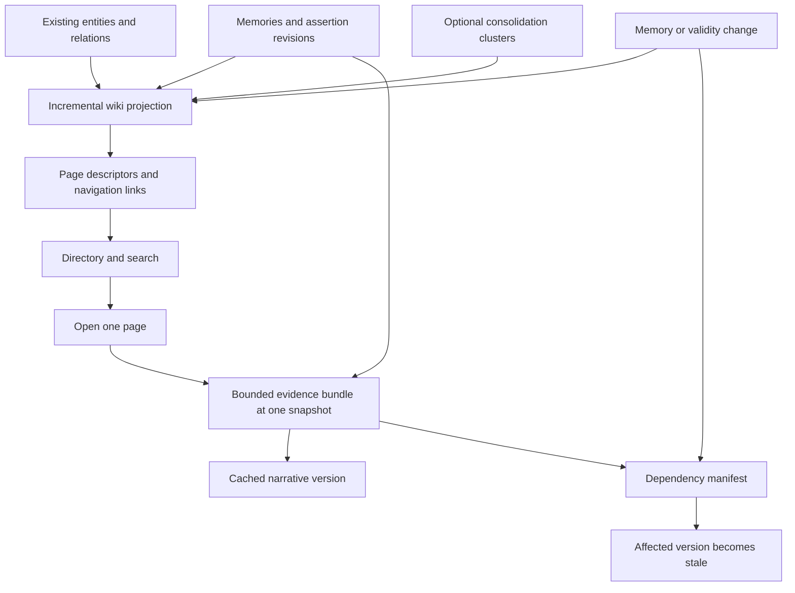

# Lazy profile wiki: a searchable graph with on-demand narrative

Date: 2026-09-14

Status: exploration and recommended direction; not an approved implementation plan.

## 1. Assessment

The idea fits Pieria well. Memories remain the authoritative substrate; a wiki becomes a human-readable view over that substrate, with prose generated only where someone wants to read it. A profile can therefore have a complete directory of discoverable topics while only a small fraction have written pages.

The strongest formulation is **an incrementally maintained page graph with lazily materialized narratives**. Each node exists before its narrative exists. It has an identity, scope, evidence membership, searchable metadata, and navigation links. Opening it evaluates a bounded generation recipe and caches the result. Memory changes update the projection and invalidate affected results, without automatically paying to rewrite them.

The main benefits are selective spending, immediate discoverability, explicit provenance, and a natural distinction between stored knowledge and its presentation. The main costs are maintaining a useful topic structure, preserving page identity through change, and making freshness reliable. Deferring synthesis does not make those problems disappear; it makes them the core engineering work.

Recommended foundations:

- Maintain a separate wiki page graph that references existing memories and entities. Reuse the evidence graph and clustering signals rather than duplicating their facts.
- Build searchable page descriptors ahead of demand. Make narrative generation lazy, not discoverability.
- Separate navigation links from generation dependencies. Following a link may generate its target; generating its source must not recursively generate its neighbors.
- Give pages stable IDs and generated versions content hashes. A changed cluster is not automatically a new page.
- Track both the evidence used by a page and the scope in which new evidence could change it.
- Treat ordinary stale prose as readable with a warning and an explicit refresh action. Forgotten evidence needs stronger handling: derived content must stop being served.
- Start with deterministic grouping, a directory, page search, and page-level synthesis. Full memory consolidation and a perfect global hierarchy are not prerequisites.

This would revise the pending [Phase 15 proposal](phases/phase-15-knowledge-graph-wiki-synthesis.md), which currently describes synthesis after ingestion. This report proposes that change; it does not silently replace the existing phase plan.

## 2. Fit with the current repository

The following reflects the source inspected for this report, rather than assuming older planning documents describe implemented APIs.

| Existing foundation | What can be reused | What remains to be built |
| --- | --- | --- |
| Memory graph and provenance | Entities, relations, and the memories supporting them | Page identity, topic membership, navigation structure |
| [GraphExplorerService](../modules/daemon/src/main/java/dev/alvo/pieria/graph/GraphExplorerService.java) | Bounded overview, neighborhoods, entity inspection, and name search | Search across all page descriptors and their evidence |
| [MemoryStore](../modules/daemon/src/main/java/dev/alvo/pieria/storage/MemoryStore.java) | Profile-scoped persistence seam, graph reads, memory lookup, temporal snapshot binding | Wiki persistence, incremental projection, dependency lookup |
| [TemporalSnapshot](../modules/daemon/src/main/java/dev/alvo/pieria/domain/temporal/TemporalSnapshot.java) and [retrieval](../modules/daemon/src/main/java/dev/alvo/pieria/retrieval/RetrievalService.java) | One world time, knowledge cutoff, and committed transaction watermark | Apply the same consistency discipline to wiki evidence and page freshness |
| [CodeSummarizationService](../modules/daemon/src/main/java/dev/alvo/pieria/code/CodeSummarizationService.java) | Existing code narrative enrichment | Optional inputs, with source provenance and their own freshness tracked |
| [Phase 11 consolidation proposal](phases/phase-11-memory-consolidation-and-reflection.md) | Proposed combination of topic keys, vector similarity, and shared entities | Conversational consolidation is still pending; no reusable cluster registry should be assumed |

Two older assumptions need particular care. Phase 15 references `graphSnapshot`, but the current graph surface deliberately exposes bounded slices through [GraphController](../modules/daemon/src/main/java/dev/alvo/pieria/api/controller/GraphController.java); `MemoryStore` no longer exposes that snapshot method. A wiki builder needs paginated internal enumeration and incremental reads, not a full graph response through the console API.

Also, older Phase 11/15 language about filtering `superseded` records and deleting historical vectors conflicts with the current [bi-temporal design](phases/phase-10-bi-temporal-fact-validity.md). Wiki visibility must follow selected validity segments and forgetting markers. The lineage flags cannot decide what is currently true.

`docs/PLAN.md` and `docs/SPEC.md`, referenced by `AGENTS.md`, are absent in this checkout. The current source, phase documents, and [feature inventory](POTENTIAL_FEATURES.md) are the basis for this exploration.

## 3. Three structures with different responsibilities

The wiki should reuse the knowledge graph without requiring the knowledge graph itself to become a document outline.

| Structure | Nodes and edges | Responsibility |
| --- | --- | --- |
| Evidence graph | Memories/assertions, entities, supported relations | What the corpus says, when it applies, and where it came from |
| Wiki navigation graph | Page descriptors, containment and related-page links | What a human can browse and search |
| Generation dependency graph | Page versions, source revisions, scope selectors, optional derived inputs | What must be reconsidered after a change |



An entity such as “SQLite” may support several pages: storage architecture, operational recipes, and migration decisions. Conversely, a page such as “Why temporal visibility replaced superseded flags” draws on several entities and a sequence of decisions. One entity per page is a useful seed, but a poor universal rule.

Likewise, a graph community is a candidate topic, not automatically a coherent article. Connectivity and semantic similarity do not establish a single subject, and a highly connected tool can link otherwise unrelated projects.

Use a shallow containment hierarchy for the table of contents, plus typed cross-links for lateral exploration. The containment structure should be acyclic; related-page links may form cycles freely. A page may have several useful entry points while retaining one canonical URL. No recursive narrative dependency is implied by containment or a related link.

Navigation edges should distinguish “contains” and “related topic” from a sourced factual relationship such as “uses.” Co-occurrence is sufficient to suggest related reading, but insufficient to assert a factual relation in prose.

## 4. Constructing the graph without writing the wiki

### Page descriptors are the eager layer

Every discoverable node needs a small descriptor before any model writes its article:

| Field | Meaning |
| --- | --- |
| Stable page ID and profile ID | Canonical identity, independent of title and content |
| Title, aliases, kind | Search and presentation metadata |
| Scope | The subject and boundaries of this page; a structured selection recipe |
| Anchor references | Topic keys, entities, namespaces, paths, or a persistent cluster identity |
| Evidence membership | Supporting memory/assertion references, allowing overlap between pages |
| Parent and related links | Navigation that already works for unevaluated pages |
| Representative excerpts and facets | Searchable, source-derived clues rather than a generated summary |
| Descriptor revision and projection watermark | Which structural state the descriptor represents |

Initially support three page kinds: directory, topic, and entity. A directory can render entirely from metadata. A topic or entity page can have a concise scope description and excerpts even before it has prose. Later, evidence-rich topics can support decision histories, timelines, and procedural views.

Do not make a generated synopsis mandatory for every descriptor. That would move a smaller version of full-wiki synthesis into graph construction. Deterministic titles from keys, entity names, paths, and representative phrases are a sufficient starting point. Optional small-model naming can improve ambiguous groups under a separate budget, cached by descriptor input changes.

### A conservative construction pipeline

1. Enumerate eligible memories under a fixed temporal snapshot, excluding forgotten content and the wiki's own generated artifacts. Track disconnected and unassigned memories too.
2. Seed groups from exact topic keys and trustworthy anchors. Key prefixes can suggest a directory, but machine-oriented namespaces are hints rather than a ready-made human taxonomy.
3. Add nearby candidates through shared entities and bounded vector or lexical neighbors. Avoid all-pairs similarity computation. Tasks need a lexical/key path because Pieria does not embed them.
4. Weight distinctive shared entities more strongly than generic hubs. Require subject compatibility before combining groups; similarity alone should not merge opposite decisions or unrelated uses of the same tool.
5. Persist soft, overlapping membership. Give each memory a primary placement where useful, while allowing it to support other pages. Preserve explicit distinctions between core evidence and contextual evidence.
6. Split groups that exceed a source-token budget or contain several independently explainable subjects. Keep sparse topics as short source cards or under a miscellaneous directory, rather than inventing substantial articles for them.
7. Select root entries for coverage and diversity, with stable ordering and optional user pins. Degree can be one signal; it should not let code symbols or generic tools dominate a profile's home page.
8. Publish descriptors, memberships, and navigation atomically for the affected region. Build the search index from the same published revision.

This pipeline is a proposed baseline, not a claim that useful clustering is solved. Measure it against a simpler topic-key/entity directory before introducing more elaborate community detection. Where embeddings are missing or graph extraction was disabled, the lexical and key paths must still produce a usable wiki.

Consolidation can later supply better clusters and observations through a shared clustering component. Wiki construction itself should not merge, retire, or rewrite canonical memories. Organizing evidence for reading has a lower confidence threshold than changing the memory substrate.

### Stability is a product requirement

Allocate a page ID when a durable subject first appears. On subsequent projection runs, reconcile candidate groups against existing pages using stable anchors, subject compatibility, and membership overlap. Use deterministic tie-breaking and a margin before moving borderline members. Fresh evidence can invalidate prose immediately without forcing a reorganization of the directory.

On a split, retain the old page as an overview when its subject still makes sense, and create narrower children. On a merge, retain one canonical identity and redirect the others. Renames change the title and aliases, not the ID. A page that loses all support becomes retired or unavailable, with a navigable explanation where appropriate. Do not reuse its ID for a different topic.

Local maintenance will sometimes produce a worse partition than a global rebuild. Accept that tradeoff initially. Run structural reconciliation as bounded maintenance, with a change report and preservation of links, rather than reclustering the entire profile on every ingest. Stable IDs require persisted identity/alias metadata; a rebuild from memories alone may reconstruct the topics but cannot promise identical old URLs.

## 5. Searching unevaluated pages

Search must operate over descriptors and source evidence, not require generated page bodies. It should not need a path from a root or a visit history.

Use two complementary retrieval routes:

- **Descriptor search:** FTS over titles, aliases, key terms, anchor names, and representative excerpts. Optional page vectors can use bounded source-derived text or a centroid; generated prose is unnecessary.
- **Evidence search:** Retrieve memories using existing evidence-tier capabilities, then map those hits to wiki page memberships. Aggregate several useful hits with diminishing returns so a huge page does not win merely by having more sources.

Fuse the routes, favor explicit title/key matches, and diversify highly overlapping results. A centroid alone is insufficient: averaging can hide a small but important subtopic. Evidence search supplies the long-tail route into that page. If reusing recall output, preserve rank by list position rather than sorting on its exposed RRF score.

Search results should show title, scope, source-derived matching excerpts, evidence count, and generation/freshness state. “Not yet generated” is a normal result state, with the same ability to open as a cached page. Generation state should not boost relevance; otherwise the wiki becomes progressively biased toward topics already visited.

Define coverage honestly. Search can reach every descriptor independently of navigation, but retrieval is still bounded and ranking is not exhaustive. Every eligible memory should have a page placement or appear in a searchable unassigned pool. When a memory hit has no suitable page, show it as evidence with an option to create a scoped page. Do not silently discard it or create a permanent article for every search query.

FTS-only search can work without any model call. Semantic search may require a query embedding; it should require no chat-model inference or narrative generation. Projection lag must be visible, and live evidence search can expose newly stored material before the background directory catches up.

## 6. Evaluating one page

### Generation contract

A page is a stable subject with a repeatable evidence-selection policy. It is not an arbitrary recall query whose interpretation changes with every visit.

For an unevaluated topic page:

1. Resolve its canonical ID and descriptor revision. Capture a source snapshot and establish that its projected membership is consistent with that snapshot, or reconcile the affected page first.
2. Select core and contextual evidence within explicit token and source-count budgets. Preserve distinct claims, relevant exceptions, contradictory assertions, and their temporal scope. Sampling only the most recent or most central facts risks misleading prose.
3. Assemble an immutable evidence bundle containing selected assertion/revision references, source text, relevant relationships, allowed page-link targets, and precomputed temporal facts. Record omitted-source counts and selection-policy version.
4. Reuse a valid cached result for the same inputs; otherwise join or enqueue one generation job for this page/version. Concurrent readers share the job.
5. Ask the synthesis tier to compose a bounded article using only that bundle. A parent overview uses its own representative evidence and child descriptors; it does not first synthesize every child.
6. Validate the output, persist the narrative and dependency manifest, then recheck relevant changes before making it current. If the inputs changed during generation, keep it as an explicitly stale version or discard it, rather than presenting it as fresh.

The live application can trigger the generation request when the reader clicks a link to an unevaluated page. Merely displaying links, hovering, crawling, or prefetching must not generate neighbors. Cached pages load directly; stale pages offer explicit refresh by default, matching the requested user control.

### Grounding and scope

Use sentence- or paragraph-level citation markers pointing to allowlisted evidence references. Resolve them to memory ID, assertion ID, revision ID, and source provenance in Java. A list of everything included in the prompt is an input manifest, not evidence that each written claim is supported.

Validate citation and link targets deterministically. Semantic entailment is harder: an existing citation ID can still be attached to an unsupported sentence. Evaluate that failure mode explicitly, and consider bounded claim verification for sensitive or disputed passages. If generation or validation fails, keep the descriptor and source excerpts usable; do not promote a malformed article.

A readable page should distinguish facts, supported interpretations, disagreements, and unknowns. It must not resolve an unresolved source conflict merely to improve narrative flow. Code summaries or future consolidation observations can be useful inputs, but carry their derivation provenance and staleness through to the page. Do not count a derived summary and its underlying evidence as independent corroboration.

Current-visible evidence alone cannot reconstruct every past decision. A future decision-history or timeline recipe must explicitly retrieve historical assertions and label their applicable periods; it must not bypass temporal filtering and present retired conclusions as current facts.

Keep the opening page focused. If its scope is too large for a faithful bounded article, generate an explicit overview with child links and a coverage notice. Silent truncation is not a satisfactory substitute for a scope boundary.

Generated text is an interpretation, not new memory. Keep it out of canonical ingestion and ordinary memory recall. Managed Markdown exports should carry artifact-origin metadata and be excluded from automatic ingestion where possible, preventing a feedback loop in which the wiki becomes evidence for itself.

## 7. Freshness and invalidation

### Separate identity, inputs, and display

Use a stable page ID for links, and an immutable version ID for each generated artifact. A conceptual narrative input fingerprint is:

```text
hash(
  profile ID, page ID, page scope revision,
  selected memory content and assertion revision references,
  relevant relationship/provenance revisions,
  evidence-selection policy and coverage metadata,
  any consumed derived-input versions,
  prompt/schema version, generation configuration and language,
  temporal inputs actually used in the article
)
```

Store the exact temporal snapshot and transaction watermark for provenance. For a current-view cache, do not put the ever-changing request timestamp or a global graph revision into every page's reuse key: doing so defeats reuse when nothing relevant changed. Reuse depends on equivalence of selected inputs, relevant scope state, and any upcoming temporal boundary. If the body includes time-relative statements such as an elapsed duration, that calculation itself introduces an expiry; prefer absolute dates where appropriate.

Track navigation metadata separately. A new sibling link or renamed related page can update a directory or related-links panel without rewriting the body. If the body actually consumes a neighbor's title, summary, or claims, that consumed input is a real dependency and must be recorded.

### The difficult case is new evidence

Reverse dependencies catch edits or removal of sources already used by an article. They do not catch a new memory that ought to have been included, because that memory was absent from the old dependency set.

Maintain two kinds of dependency:

- **Materialized dependencies:** the actual sources, revisions, derived inputs, and relationships used in the generated version.
- **Scope dependencies:** the topic keys, fact groups, anchor entities, paths, membership sets, and selection buckets whose changes require reconsidering the page's evidence bundle.

For semantic membership, route each changed memory through bounded candidate-page matching and reconsider nearby memberships. Where that routing cannot guarantee completeness, conservatively dirty a containing topic partition and reconcile it before claiming freshness. Periodic reconciliation catches missed assignments and drift; it must not be the only mechanism protecting the “current” label.

Maintain separate states for **needs checking** and **stale**. A routed change can require a deterministic re-selection without changing the final bundle. If its fingerprint remains equivalent, retain the cached narrative and clear the check without a model call. Even a non-selected new memory may alter coverage or introduce an exception, so scope-level checking must consider more than the previous prompt's IDs.

### Changes and their effects

| Change | Structural response | Narrative response |
| --- | --- | --- |
| New unrelated memory | Add/update its local topic | Existing unrelated versions remain reusable |
| New relevant memory | Update membership and search | Recheck the page; mark stale if its generation inputs change |
| Correction to a source assertion | Re-resolve affected fact group and memberships | Invalidate versions depending on the changed interpretation, even if topology is identical |
| New navigation-only link | Update links and descriptors | No synthesis unless the body depends on that relationship |
| Expiry or future assertion becoming valid | Re-evaluate affected scope at its next boundary | Recheck even though no new ingest occurred |
| Cluster split or merge | Reconcile identities, memberships, redirects | Recheck affected scopes; keep unrelated pages intact |
| Prompt or model configuration change | No evidence graph change required | Mark rendering as eligible for upgrade, separately from evidence staleness |
| Forgetting | Remove evidence from visible descriptors, memberships, and search | Immediately suppress dependent bodies and cached excerpts, including old versions |

The expiry row matters especially for Pieria. World-time visibility can change while the daemon receives no writes. Track the earliest relevant validity boundary across scope candidates, including scheduled replacements, and recheck on access as well as through background maintenance. Use the shared temporal predicate; an expired override can restore its underlying assertion.

### Transaction and worker behavior

Write a compact wiki-change event in the same transaction as the source mutation. A daemon-owned worker drains a durable outbox, coalesces work, updates memberships/descriptors, and marks affected pages for checking. Graph attachments arriving after memory ingestion, embedding completion used for clustering, and future consolidation changes need their own relevant events. The existing vectorization pattern is useful, but a comprehensive wiki change feed is new work.

A page response should distinguish the corpus watermark, projection watermark, and narrative's input state. If the worker is behind, show “checking for updates” or reconcile the relevant pending changes before returning “current.” A previously stored boolean `stale=false` is insufficient proof of freshness.

Do not hold a SQLite write transaction open during inference. Materialize the bounded bundle, release database resources, generate, then publish under a short conditional transaction that verifies the descriptor/scope generation and forgetting state. Prevent an older completion from replacing a newer version. Deletion of the whole profile must also cancel or reject outstanding jobs.

Treat generation state and freshness as separate dimensions: `absent / queued / generating / ready / failed` alongside `current / needs-check / stale / unavailable`. A ready old body can remain readable while its refresh is generating; a failed refresh need not erase that body.

Forgetting is stronger than ordinary invalidation because serving an old interpretation would retain content Pieria promises to hide. Immediately block serving dependent derivatives, then purge/rebuild their bodies, descriptors, snippets, and indexes. Enforce a read/publication check so a lagging worker or in-flight model response cannot resurrect them. External Markdown copies cannot be remotely revoked; a managed export can reconcile them on the next sync, and must state that limitation.

## 8. Reading experience and Markdown/Obsidian

### Live wiki

The home page should work before any narrative is generated. Show a stable topic directory, search, and a small optional overview. Opening a topic immediately displays its title, scope, links, and available evidence while the prose is generated. Each page exposes its sources and states whether it is current, not generated, being checked, or stale.

A stale page should say what changed: for example, “Three sources added; one assertion corrected,” with a refresh action. A later enhancement can show a narrative diff, but an evidence-change explanation is useful before paying for another generation.

“Current” means aligned with the selected profile evidence, not independently verified against the outside world. The UI should also distinguish a historical article from a stale current article.

### Export is a different execution environment

Obsidian supports internal links in both Markdown and wikilink formats. A stable filename such as `pages/<page-id>.md` with a readable alias avoids breaking links on title changes. See the official [internal-link documentation](https://help.obsidian.md/links).

An ordinary Markdown link is navigation, not a request to the Pieria model. A static vault alone cannot provide automatic generation on opening an unevaluated node. That requires a live application, a dedicated integration, or an explicit action leading back to Pieria. This is an architectural distinction, rather than a limitation of the graph concept.

Offer three possible modes:

| Mode | Behavior | Cost/limitation |
| --- | --- | --- |
| Snapshot export | Export generated pages plus descriptor stubs and index files | No inference; offline links reach stubs for unevaluated pages |
| Selected materialization | Generate a chosen set or bounded subtree, then export | Explicit budget; finite offline reading set |
| Live Obsidian integration | Opening a stub asks the daemon for that page and updates the managed file | Requires an integration and a running daemon |

Start with the live console and snapshot export. Stubs should include scope, existing topic links, state, and a link back to the live reader. Exported search can find stub metadata; full search through all source evidence remains a daemon capability unless the export deliberately includes a richer index. Do not claim parity between these two search surfaces.

Use a managed generated directory and preserve annotations separately. A manifest should track page IDs, filenames, version fingerprints, and exported file hashes. If a generated file has been edited by the user, write a conflict copy or skip it with a report instead of overwriting it. Annotations must not silently enter canonical memory; offer an explicit ingest action if desired. Exported snapshots should carry their dates and staleness state rather than implying ongoing synchronization.

## 9. Cost model and failure modes

Let `N` be the number of potential pages, `V` the distinct pages actually opened, and `R` the stale page versions explicitly regenerated during an observation period. Let `Cpage` be the average input-plus-output token cost of one page, and `Cstructure` the model cost of any optional structure/naming work.

```text
Eager initial synthesis ≈ N × Cpage
Lazy synthesis         ≈ (V + R) × Cpage + Cstructure
```

Both approaches also pay for initial indexing and ongoing projection maintenance. The formula abstracts variable page sizes, retries, verification, query embeddings, and any eager root overview; those must be included in measurements.

For illustration only: 1,000 potential pages, 40 visited pages, 10 refreshes, and 6,000 input-plus-output tokens per article imply about 6 million tokens for an eager initial wiki versus 300,000 narrative tokens for the lazy usage period, before the omitted overheads. This is arithmetic, not a Pieria benchmark or a monetary estimate.

Savings depend on readership. If readers eventually visit every page and continually refresh them, the avoided-generation advantage shrinks. If clustering is rebuilt frequently through large prompts, structural work can consume the savings. Local models also incur latency and hardware contention even without per-token API billing.

| Risk | Why it matters | Proposed control |
| --- | --- | --- |
| Topic drift | A bookmarked page quietly changes subject | Stable anchors, scope revisions, conservative reassignment, redirects |
| Expensive first click | Reading waits for inference | Immediate descriptor/evidence view, bounded articles, shared jobs |
| High-degree hubs | Huge prompts and vague home pages | Diversity in root selection, topic facets, explicit split thresholds |
| Missing graph coverage | Valid memories disappear from the wiki | Key/lexical fallback, searchable unassigned pool, coverage metrics |
| False coherence | Contradictions become a confident single story | Temporal selection, conflict sections, claim-level provenance |
| Global invalidation | One update makes the whole wiki expensive | Scope routing and local fingerprints; no global hash in every cache key |
| Hidden stale answers | Change worker falls behind | Watermark-aware reads, deterministic rechecks, visible uncertainty |
| Repeated summaries | Overlap causes duplication and recursive model cost | Canonical topics, contextual cross-links, no neighbor-body dependency by default |
| Concurrent demand | Page opens contend with ingest and recall | Bounded background inference, interactive-request priority, cancellation and budgets |

A page-specific retry cap and timeout should leave evidence browsing usable. Model unavailability must not make the directory or lexical search unavailable. Track structural computation, embeddings, inference, validation, and retries separately so “lazy” does not disguise a cost transfer.

## 10. Related approaches and what to borrow

Microsoft's GraphRAG dataflow explicitly separates an entity graph, hierarchical communities, and generated community reports. This supports the distinction between organizational structure and readable interpretation. Its documented default pipeline generates reports during indexing, which is the step this proposal would defer. The lesson to borrow is the separation of artifacts, not the eager report-generation policy. [GraphRAG indexing dataflow](https://microsoft.github.io/graphrag/index/default_dataflow/).

Microsoft Research's LazyGraphRAG explores deferring LLM work until queries rather than requiring precomputed summaries. It is a useful precedent for paying for interpretation at the point of demand. Its target is query answering, however; a persistent wiki additionally needs stable page identity, navigable stubs, artifact versions, and update semantics. Its reported retrieval results do not establish wiki quality or expected savings for Pieria. [LazyGraphRAG research article](https://www.microsoft.com/en-us/research/blog/lazygraphrag-setting-a-new-standard-for-quality-and-cost/).

The cache and invalidation design can also be understood as a build-system analogy: descriptors identify targets, evidence bundles supply inputs, manifests record dependencies, and generation creates artifacts. This is an architectural analogy proposed here. Its limit is semantic dependency discovery: unlike a compiler's explicit imports, a new memory can become relevant to an existing topic without naming that page.

## 11. Suggested implementation boundary

Keep the first implementation inside the daemon and SQLite, behind profile-scoped store methods. A new graph database is unnecessary for page membership, adjacency, FTS, reverse dependencies, and a work queue. Shared request/response DTOs belong in `shared`; frontend and CLI clients must use the daemon rather than opening its database.

A conceptual persistence model—not a migration specification—is:

| Record | Purpose |
| --- | --- |
| `wiki_pages` | Stable identity, scope, aliases, lifecycle, descriptor revision |
| `wiki_memberships` | Page-to-evidence assignments and membership role |
| `wiki_links` | Typed navigation and relationship references |
| `wiki_page_versions` | Immutable body, input fingerprint, snapshot, coverage, generation configuration |
| `wiki_dependencies` | Materialized input references and scope invalidation selectors |
| `wiki_changes` / jobs | Durable projection work, retries, deduplication, generation leases |
| Descriptor search index and redirect map | Lookup before synthesis and continuity after structural changes |

All records and unique constraints must be profile-scoped. Keep the database authoritative for the derived wiki state; `.md` files are an export projection. Store identity/redirect metadata in profile backup/export if stable links must survive restoration. Generated prose can be evicted or rebuilt independently, subject to retention preferences.

An illustrative API separates cheap reads from inference:

| Operation | Behavior |
| --- | --- |
| `GET /v1/profiles/{name}/wiki` | Directory, graph/projection state, counts; no synthesis |
| `GET .../wiki/search?q=...` | Search descriptors and mapped evidence; no chat-model call |
| `GET .../wiki/pages/{id}` | Descriptor, links, cached body and freshness; no synthesis |
| `POST .../wiki/pages/{id}/evaluate` | Join/enqueue initial generation or explicit refresh; return cached result or job handle |
| `GET .../wiki/jobs/{jobId}` | Progress and resulting version |
| `POST .../wiki/exports` | Create a snapshot export; selected generation only when explicitly requested |

The UI can call `evaluate` automatically upon a deliberate open of an absent page. This preserves the desired click-to-generate behavior while preventing link previewers and ordinary GET requests from spending inference tokens. Requests should include the expected descriptor revision or input identity so duplicate actions coalesce and outdated refreshes can be detected.

## 12. A staged path and how to judge it

### Stage A: validate the map before generating prose

Build the descriptor projection, stable identity reconciliation, shallow directory, and search. Use existing keys/entities plus lexical fallback. Include a basic delta path and unassigned coverage. No large-model calls are needed.

Inspect representative profiles, including a sparse graph, a code-heavy profile, and a conversation-heavy profile. Compare the proposed grouping with the simpler entity/key baseline. Measure whether humans can find the intended topic directly, whether titles communicate scope, and whether ordinary additions reorganize unrelated pages. Do not invest in article polish if the map itself is not useful.

### Stage B: make one page reliably lazy

Add bounded evidence bundles, cited generation, content fingerprints, a version cache, job coalescing, and the live reader. Support absent/current/stale/error states. Include dependency/scope invalidation, scheduled validity boundaries, forgetting protection, and conditional publication in this stage; freshness is part of the feature rather than a later optimization.

The first useful product needs neither whole-profile synthesis nor automatic prose refresh. A deterministic directory plus individually generated topic pages already fulfills the central concept.

### Stage C: improve structure and portability

Add richer semantic assignment, optional small-model naming, consolidation integration when available, pins and aliases, managed Markdown export, and evidence-change explanations. Offer selected offline materialization with an explicit budget. Full historical navigation graphs, live Obsidian synchronization, section-level incremental generation, and automatic warming of popular pages can wait.

Historical page support should be an explicit later contract. The current MVP uses current-world/current-knowledge visibility and retains generation provenance; retaining an old body alone does not implement correct arbitrary `asOf`/`knownAsOf` browsing. That requires reconstructing or versioning descriptors, memberships, search, and dependencies at the same cutoff. Unversioned code-graph inputs cannot silently enter historical pages.

### Acceptance scenarios

- Search finds a useful page before its first generation, including a topic reachable only through evidence text and a disconnected memory with no graph edges.
- Opening the directory and running lexical search makes zero model calls; opening one absent page makes no calls for neighbors or descendants.
- Reopening an unchanged generated page makes zero synthesis calls. Concurrent readers produce one generation job per input version.
- An unrelated insert leaves another page reusable. A relevant new source that was never cited triggers re-selection and, when necessary, staleness.
- A correction affecting assertion provenance invalidates the right page even when entity/edge topology is unchanged.
- Future validity starts and bounded-override expiry change current page freshness without ingestion. Forgetting cannot restore competing assertions or expose prior cached prose.
- A source update or forgetting during inference cannot publish the old result as current. Worker lag cannot produce a misleading current label.
- A split, merge, or rename preserves old links through stable IDs, overviews, or redirects. User pins do not conceal newly relevant evidence.
- Missing embeddings, a failed model call, or insufficient evidence still leaves usable descriptors and source inspection.
- Snapshot export has resolvable links/stubs, records freshness, and preserves user modifications. Re-ingesting managed exports does not recursively multiply derived evidence.
- Profile boundaries hold across search, jobs, caches, citations, redirects, and export.

Measure total tokens and latency across a replay of changes plus reader visits, rather than only the first build. Track page-ID churn, unrelated invalidation rate, missed relevant updates, projection lag, search success, unsupported-claim rate, evidence coverage, cache hits, and first-open latency. Grounding and navigability require human review in addition to deterministic tests; a model-written judgment alone is insufficient proof.

## 13. Additional ideas worth preserving

**Evidence mode as a first-class view.** A page can remain useful without synthesis: title, key facts as verbatim excerpts, links, dates, and sources. This makes the wiki available when the model is offline and gives the reader a way to check its interpretation.

**A knowledge-change inbox.** Collect changes to pages the user follows: new evidence, changed conclusions, split topics, and retired assertions. Prefer source-change descriptions before automatic narrative diffs. This makes the wiki an interface to memory evolution as well as a reference library.

**Reader-owned structure.** Allow a small set of overrides—preferred title, pinned root, alias, scope hint, or hidden navigation item—stored separately from generated descriptors. Hiding a topic from navigation should not erase its memories or bypass freshness. These controls can stabilize the wiki without making the user manually maintain its prose.

**Several views over one page identity.** An overview, timeline, procedure, or decision history could share the same subject descriptor and source membership, with separate generation recipes and caches. Introduce these only when a profile has enough evidence to support them; multiple renderings are not multiple truths.

**Explicit “prepare for offline reading.”** A user can select a topic, set a depth/page/token budget, and materialize that finite slice. This complements lazy reading without making eager synthesis the default.

## 14. Recommendation

Proceed with an exploration prototype centered on the descriptor graph and search. The decisive experiment is whether Pieria can cheaply maintain a useful, stable map of its memories. Page prose is comparatively straightforward once the subject boundary and evidence bundle are good.

For a revised Phase 15, adopt a separate derived page graph, stable page IDs, lazy bounded synthesis, search over descriptors plus evidence, and explicit per-page freshness. Use the existing evidence graph and temporal semantics, but remove the assumptions of one entity per article, whole-snapshot hashing, and automatic narrative regeneration after ingestion.

The largest unresolved choices are the quality/cost tradeoff in topic assignment, how aggressively to reorganize existing pages, and how much offline integration users actually need. These should be settled with a descriptor-first prototype and observed reading patterns, rather than a full-wiki generator whose costs are already committed before anyone reads it.
